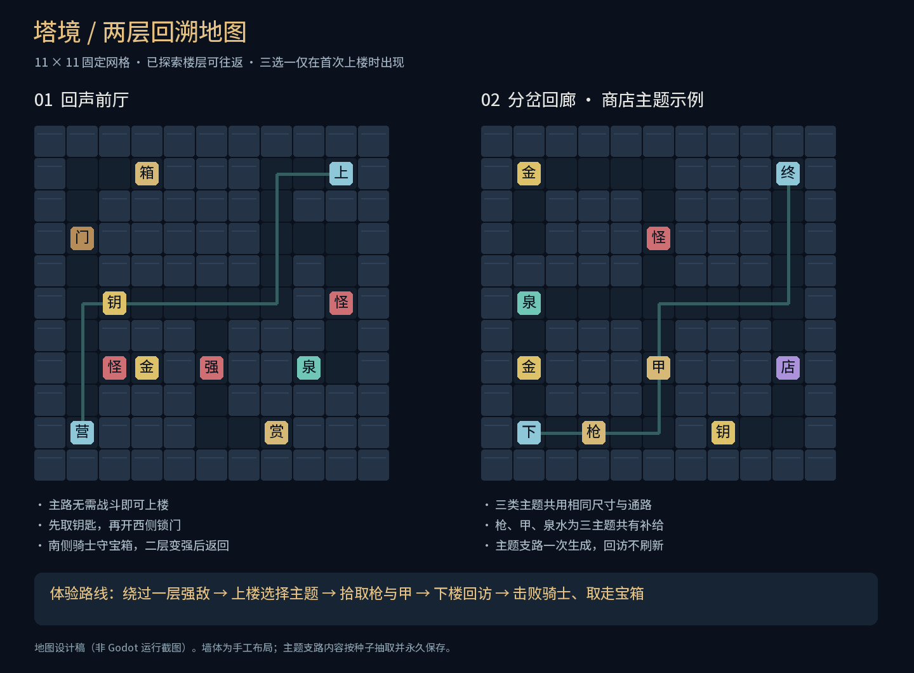

# 两层回溯地图设计

这一版按用户确认的方向改为经典魔塔式方格移动。先做两层可往返的手工地图，验证“暂时绕过强敌 → 后面变强 → 返回领取奖励”，再接完整随机地图。



图为根据实际地图数据绘制的设计稿，**不是 Godot 运行截图**。第二层图示使用商店主题；另外两类主题共用相同墙体。

## 地图规则

两层均为 11×11 格（边界墙包括在内），只允许四方向移动。所有格子可见，没有雾区。界面保持竖屏；屏幕方向按钮固定在底部，地图与说明区域可滚动。人物是青色斗篷占位角色，普通怪为红色、回溯强敌为紫色。

地图内的墙体、入口、楼梯和物件位置均为当前手工设计。主题内指定池的怪物与奖励会按种子选择，且只选择一次。后续程序化生成应复用目前的数据结构和检查方法。

## 第一层：回声前厅

坐标以左上角为 `(0,0)`，下表为 `(x,y)`：

| 位置 | 内容 | 设计意图 |
| --- | --- | --- |
| (1,9) | 入口营地 | 安全出生点 |
| (9,1) | 上行楼梯 | 不必击杀任何怪物即可到达 |
| (2,5) | 一把通用钥匙 | 位于主路、锁门外 |
| (1,3) → (3,1) | 铜锁门 → 铁甲宝箱 | 教学“消耗钥匙换防御”，开门后永久通行 |
| (2,7) → (3,7) | 史莱姆 → 30 金币 | 低风险支路，可用作商店资金 |
| (5,7) → (7,9) | 空心骑士 → 王权指环与 30 金币 | 初始难以击败；奖励只能从骑士位置经过 |
| (9,5) → (8,7) | 骷髅 → 恢复 35 HP 的药水 | 用战斗成本换治疗的可选支路 |

一层有 38 个通路格。主路从左下到中部横廊，再沿东侧向上进入楼梯，绕开南侧强敌。强敌支路只有一个入口，防止绕路直接领取其宝箱。

## 第二层：分岔回廊

二层有 40 个通路格，入口为 `(1,9)` 下行楼梯。共有补给为 `(3,9)` 的破晓长枪、`(5,7)` 的骑士板甲、`(1,5)` 的一次性泉水，以及 `(1,7)` 的 30 金币。公共路线无需战斗即可走通；顶部 `(9,1)` 的标记说明两层原型到此，可返回继续探索。

长枪与板甲是本次验证路线的固定补给，不代表正式游戏会在第二层无条件提供同等强度物品。其用途是让没有购买局外升级、未拾取一层护甲的玩家也能验证回溯循环：满血、20 攻、9 防，对骑士预计损失 77 HP。

首次从一层进入时有以下三选一：

| 类型 | 北侧支路 | 东南支路 |
| --- | --- | --- |
| 战斗层 | 骷髅 / 赤翼蝠守着狼牙 / 嗜血剑与金币 | 史莱姆 / 骷髅守着金币 |
| 宝藏层 | 铜门守着长弓 / 塔盾与金币，门后另有备用钥匙 | 可直接取得钥匙与生命吊坠 / 决斗手套宝箱 |
| 商店层 | 史莱姆 / 骷髅守着 35 金币 | 商人提供长弓、塔盾、药剂，后方可取钥匙 |

商人站位可通行。进入商人格打开交易，取消交易后人物仍可继续向前；不强制购买才能通过。

## 往返与交互

- 首次接触上行楼梯：显示三种主题，可取消并继续探索；确认后生成二层并记录主题。
- 已有二层时再次接触楼梯：直接确认前往，不再出现三选一。
- 下楼：落在一层上行楼梯格；上楼：落在二层下行楼梯格。到达楼梯格不会自动再次传送。
- 敌人与门：人物停在相邻格，先预览再确认，可取消并绕行。
- 战斗：使用旧版同一 `TowerCombat.simulate()` 函数；击败后删除该怪物实体，死亡结束本次地图探索。
- 钥匙、金币、装备箱、药剂：踏入即拾取，立即保存并移除。药剂满血也会消耗，地图说明会提示，可先绕行。
- 商店：本局每位商人最多售出一件，不买可以以后回来；售出后不刷新。
- 取得一层试炼宝箱后显示目标完成，地图仍可探索；原型没有第三层。

## 数据和存档

```text
MapState
  mode / seed / rng_state
  floor / position
  player                       跨楼层共用
  floors["1"], floors["2"]      只存已生成的楼层
    rows                       墙与通路
    entities["x,y"]            未清理实体，以及楼梯 / 商人等持久实体
    entry / exit / theme
  pending                      待确认战斗、开门、楼梯或三选一
  completed / objective_complete
  last_report / last_message
```

返回楼层只切换 `floor` 和人物坐标，不调用地图生成器。种子与 RNG 状态为字符串；选择主题、移动、结算都统一保存全部楼层。新版与旧版存档分开，避免破坏已有十层卡片模式进度。

## 已检查与待验收

已执行 Python 检查：固定尺寸、边界墙、全图几何连通、物件无重叠、引用有效、主路无需战斗或钥匙、共有补给可达、钥匙能在开门前取得、强敌和锁门无法绕开直接取奖励。设计图已检查排版。

已编写但未执行 Godot 测试：四向移动与防远程交互、钥匙不能重复拾取、致死确认、二层变强后返回击杀、宝箱不重复发奖、开门状态保留、商人通行与交易状态保留、楼层选择只出现一次、跨层存档、选择界面续存、固定 seed 与备份恢复。

未执行 Godot 导入与运行，游戏中的触控、文字、绘制、布局、键盘操作和窗口适配仍需引擎验证。当前可查看的是设计稿，不是经过引擎截图验收的成品。

## 后续随机生成约束

第一步可在固定 11×11 尺寸内随机抽取或镜像布局模板，再改变安全支路中的内容点。完成模板验证后，再加入通路生成算法。

每次生成仍需满足：上下楼梯可达、至少一条相对安全的主路、强敌不会堵死普通层的唯一上楼路线、钥匙在对应锁门外可得、物件不重叠、奖励不能绕过其守卫、生成后永久保存。完整十层的战斗预算和 Boss 门槛需要重新设计，不能直接照搬旧版每层只结算一次的数值。
