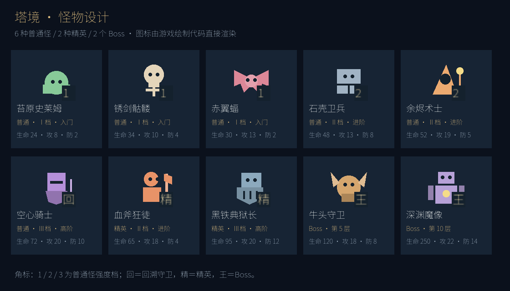

# 怪物设计：种类、等级与地图投放

状态：两层原型第一阶段已实现，2026-09-29。10 个怪物模板已补充身份、档次 / Boss 阶段与战斗特点；地图已接入独立图标、文字角标、详情与投放校验。数值是原型测试基线，不代表十层地图已完成平衡。



图为 Godot 4.5.1 调用游戏绘制代码生成的图标预览，六种普通怪、两种精英、两个 Boss 均有独立轮廓；当前两层仍只投放本方案指定的普通怪。精英与 Boss 的图标、元数据已准备，十层地图投放留待扩展。

依据：[原始设计](../肉鸽魔塔_V0.1_游戏设计文档.md)、[当前随机地图](RANDOM_MAPS.md)、[历史回溯地图](MAP_DESIGN.md)、`data/content.json` 与 `data/random_maps.json`。地图规则以当前随机地图为准：11×11、四向移动、允许跨层回溯、首次生成后保存。

## 1. 总体方案

首版沿用 **6 种普通怪、2 种精英、2 个 Boss，共 10 个怪物模板**。怪物按普通、精英、Boss 分为三种身份；普通怪再按成长阶段分为三个强度档，不给每只怪额外制作多套升级版本。

- 种类决定战斗特点：低威胁、均衡、高攻、厚甲等，让攻击和防御成长各有收益。
- 强度档决定适合何时挑战：Ⅰ档入门、Ⅱ档进阶、Ⅲ档高阶。档次是内容配置标签，不承诺所有构筑下伤害严格递增。
- 地图职责决定放在哪里：资源守卫、成长守卫、回溯守卫、楼层 Boss。同一个模板可以承担不同职责。

例如空心骑士是Ⅲ档普通怪，在第一层承担回溯守卫职责；不因站在宝箱前就自动变成精英。精英有独立模板和更高规格奖励，Boss 有独立机制和进度门槛。

怪物不随玩家属性动态升级，不因回到旧楼层刷新，也不随机浮动攻防。玩家拿到装备后，旧怪的战斗损失应实实在在下降。

## 2. 六种普通怪

以下数值直接来自现有内容配置；生命 / 攻击 / 防御采用同一顺序。

| 档次 | 怪物 / ID | 生命 / 攻击 / 防御 | 战斗特点 | 推荐地图职责 |
| --- | --- | --- | --- | --- |
| Ⅰ 入门 | 苔原史莱姆 `slime` | 24 / 8 / 2 | 低威胁，适合第一次确认战斗 | 小额金币、早期成长装备守卫 |
| Ⅰ 入门 | 锈剑骷髅 `skeleton` | 34 / 10 / 4 | 均衡，比较先拿攻击还是防御的收益 | 普通金币支路 |
| Ⅰ 入门 | 赤翼蝠 `bat` | 30 / 13 / 2 | 低防高攻，缩短战斗或提高防御都有效 | 较高收益支路，不作为开局必打怪 |
| Ⅱ 进阶 | 石壳卫兵 `sentinel` | 48 / 13 / 8 | 厚甲，鼓励先找武器再挑战 | 装备或遗物支路 |
| Ⅱ 进阶 | 余烬术士 `warlock` | 52 / 19 / 5 | 高攻击，对生命预算形成压力 | 高收益金币、进阶奖励支路 |
| Ⅲ 高阶 | 空心骑士 `knight` | 72 / 20 / 10 | 血量与防御都高，适合明显的成长门槛 | 回溯宝库、后期高价值支路 |

首版普通怪只用攻防血差异。赤翼蝠没有闪避，术士没有无视防御的法伤；避免名称暗示尚未实现的机制。随机暴击、闪避、持续中毒、远程伤害等留待基础路线验证后再考虑。

### 战斗代价参考

使用现有普通战斗公式，玩家先手且最后一击不受反击。下表假定无击杀回血等额外效果。

| 怪物 | 初始 10 攻 / 5 防 | 成长后 20 攻 / 9 防 |
| --- | --- | --- |
| 史莱姆 | 6 HP | 0 HP |
| 骷髅 | 25 HP | 2 HP |
| 赤翼蝠 | 24 HP | 4 HP |
| 石壳卫兵 | 184 HP，100 血时致死 | 12 HP |
| 余烬术士 | 140 HP，100 血时致死 | 30 HP |
| 空心骑士 | 1065 HP，100 血时致死 | 77 HP |

表内为假定玩家能坚持到击杀的理论总受伤，用于比较门槛；实际模拟在玩家死亡时立即停止，游戏预览应直接显示“会死亡”，不能把理论超额受伤当作实际扣血。20 攻 / 9 防来自当前两层原型的长枪与板甲，只是回溯验证锚点，不是未来第二层的正式成长曲线。

## 3. 精英与 Boss

| 身份 | 怪物 / ID | 当前生命 / 攻击 / 防御 | 定位及投放 |
| --- | --- | --- | --- |
| 精英，Ⅱ档 | 血斧狂徒 `berserker` | 65 / 18 / 4 | 高攻低防；完整十层的 3～4 层可选挑战，守进阶装备或遗物 |
| 精英，Ⅲ档 | 黑铁典狱长 `warden` | 95 / 20 / 12 | 高血厚甲；完整十层的 8～9 层可选挑战，守高价值构筑奖励 |
| Boss，固定阶段 | 牛头守卫 `minotaur` | 120 / 18 / 8 | 第 5 层；每第 3 次玩家攻击后，存活时攻击 +2，立即用于反击 |
| Boss，固定阶段 | 深渊魔像 `golem` | 250 / 22 / 14 | 第 10 层；受击后按累计掉血每 50 HP 增加 2 防御 |

精英首版仍使用确定性普通战斗。精英身份表示奖励规格和挑战定位，不保证比所有普通怪都更难；例如厚甲骑士对低攻构筑可能比狂徒更危险。

Boss 使用现有逐回合模拟。其数值沿用旧卡片模式，需要按方格地图连续战斗后的资源重新校准。当前两层地图不添加 Boss，也不强行塞入全部 10 种怪物。

## 4. 地图放置方法

沿用“安全主路 + 四条主题支路”的模板结构。先确定支路用途和奖励，再在合适档次的怪物池中抽守卫。不要从全部怪物里随机抽取后随便放在空格上。

```text
入口 ───────── 安全主路 ───────── 楼梯
                 │       │
             普通守卫   回溯守卫
                 │       │
              金币奖励  高价值宝箱

另外两条支路可放锁门装备、开放治疗、宝库等。
此图表达连接关系，不是固定坐标；支路方向和位置随模板变化。
```

### 必须满足的规则

1. **普通层主路可安全通行。** 将所有怪物和锁门视为不可通行时，入口、上下楼梯及必要安全补给仍连通。第一轮继续使用当前较强的“主路零战斗”约束。
2. **守卫必须真正守住奖励。** 将某个守卫格单独视为墙、其他可清理障碍视为可通行，从入口仍不能走到对应奖励；移除该守卫阻挡后应有到奖励的路线。多入口房间必须修改墙体或位置，不能靠视觉摆放假装封路。
3. **成长门槛不能循环依赖。** 第一层骑士不能守着击败它所必需的唯一武器；用于回打它的基础装备要通过更弱的守卫或安全可得的对应钥匙取得。
4. **入口和返程落点保持安全。** 不在出生格、楼梯格、商人格或唯一返回通路放怪。玩家看过损失后可以取消、离开或下楼。
5. **当前每条战斗支路只放一只守卫。** 先保证一场战斗对应一个可理解的收益；后续若设计连续战斗，必须计算全支路累计受伤与中途补给。
6. **钥匙按类型保证可得。** 铜、银、金钥匙不混用；继续在所有门和怪物之外提供本层开门所需的对应钥匙，不能用普通怪堵住这些保障钥匙。
7. **首次生成后固定。** 怪物、奖励与守卫关系只生成一次，击败后永久移除；跨层、重载和变强均不重新抽怪。
8. **特殊门槛提前可见。** 普通守卫、回溯守卫、精英和 Boss 用名称或标记区分，不能只靠颜色。显示属性、机制、当前预计损失及其守护奖励。

生成器现有 `guard_links`、实体 `role` 与 `guardian` 可继续承担位置关系和回溯标记；身份与强度档是建议新增的内容元数据。

## 5. 当前两层的具体投放

下表与现有四支路配方一致，可作为本次怪物设计的第一阶段落点。

| 楼层 / 主题 | 怪物数量 | 四条支路配置 |
| --- | --- | --- |
| 第一层：入口层 | 2 只 | 空心骑士 → 王权指环；史莱姆或骷髅 → 金币；铜门 → 护甲；开放治疗 |
| 第二层：战斗层 | 3 只 | 史莱姆 → 长枪；银门 → 板甲；赤翼蝠或石壳卫兵 → 遗物；史莱姆或骷髅 → 金币 |
| 第二层：宝藏层 | 1 只 | 史莱姆 → 长枪；银门 → 板甲；金门 → 宝库；开放宝箱 |
| 第二层：商店层 | 2 只 | 史莱姆 → 长枪；银门 → 板甲；史莱姆或骷髅 → 金币；开放治疗；商人在安全主路附近 |

这里的“或”是同一位置抽一只，不是同时摆两只。第一层骑士固定存在，第二层长枪守卫固定为史莱姆；这两处是回溯体验的保障，不放进任意抽池。

推荐验证路线：绕过骑士 → 安全上楼 → 击败长枪史莱姆 → 取得长枪和银钥匙 → 开银门拿板甲 → 回一层挑战骑士 → 领取试炼宝箱。银钥匙也可先取；顺序不影响路线成立。

无局外升级、未拿一层护甲、无额外治疗或其他战斗时，100 HP 初始角色先损失 6 HP，取得 20 攻 / 9 防后对骑士损失 77 HP，最后剩 17 HP。该路线展示可达性与回溯价值，允许其他自选战斗导致资源不足。

当前 `small_fight` 中骷髅的开局成本为 25 HP，而史莱姆为 6 HP；`relic_fight` 的蝙蝠与卫兵也不等价。它们属于可绕行的收益差异，不能用“同池”推断等难。将来若用作必须取得的成长支路，需固定守卫或按战斗预算重新分池。

## 6. 扩展十层时的投放草案

以下仅用于后续十层方格地图；现在不据此修改两层生成器。沿用每层四支路时，普通主题目标为 2～3 只怪，战斗主题最多 4 只，宝藏和商店主题 1～2 只。精英与回溯守卫占用其中的名额，不另外叠加数量。

| 楼层 | 常规怪物池 | 特殊安排 |
| --- | --- | --- |
| 1～2 | Ⅰ档：史莱姆、骷髅、赤翼蝠；早期必要成长固定弱怪 | 1 层保留一只可绕过的Ⅲ档骑士；当前两层试炼仍以第 5 节为准 |
| 3～4 | Ⅰ档与Ⅱ档混合：引入卫兵、术士 | 3～4 层合计安排一次狂徒精英挑战，位于可选支路 |
| 5 | 牛头守卫 | 安全准备区 → Boss → 上楼；Boss 不可绕过，战前允许返回下层 |
| 6～7 | Ⅱ档为主，少量Ⅲ档骑士 | 提供下一阶段成长，少量低档怪用于体现变强后的收益 |
| 8～9 | Ⅱ档与Ⅲ档混合 | 8～9 层合计安排一次典狱长精英挑战，位于可选支路 |
| 10 | 深渊魔像 | 安全准备区 → 最终 Boss → 通关 |

Boss 层单独使用模板与验证规则，是“普通层安全主路”的明确例外。不能直接把 Boss 放在目前允许无战斗到达的楼梯旁，否则玩家可能绕开它上楼。

每个阶段先定义不依赖局外升级的参考装备路线，再用真实战斗模拟检查：成长守卫可承受、至少有一条路线能完成阶段、精英可以绕过、Boss 前有足够资源。不要直接把旧卡片模式的每层战斗数值乘以地图怪物数量。

## 7. 奖励与生命预算

奖励分为即时击杀金币和守卫后方可拾取的资源，预览应分别显示。支路总金币 = 怪物 `gold_reward` + 地图金币 / 宝箱金币，不能平衡时漏算后者。例如当前普通金币支路，史莱姆总计 38～53 金币，骷髅总计 44～59 金币。

- 资源守卫：金币或补给，支撑商店选择；不要求每只怪都掉装备。
- 成长守卫：指定阶段装备，确保拿到后能改善其他战斗。
- 回溯守卫：显著高于普通支路的构筑奖励，让返回值得，但避免守住自己唯一的解法。
- 精英：明确的遗物或进阶装备奖励。地图版优先使用身后单次宝箱；若做二选一，需要另接奖励选择状态，不能假定旧卡片模式流程已经接入。
- Boss：阶段通行权与阶段奖励；击败最终 Boss 才结束完整十层流程。

治疗支路若有怪物，按“实际恢复量 − 战斗损失”评估净收益，并考虑最大生命上限。当前保留开放治疗，避免唯一救命补给被致死怪堵住。全局同时核算金币、商店价格、钥匙与回血，尤其避免多打几只旧怪带来的金币成长远超预期。

## 8. 数据落地与验收

已给怪物定义添加 `rank`（normal / elite / boss）、`tier`（普通、精英为 1～3）或 `boss_floor`（Boss 的 5 / 10 层），以及 `combat_hint`。维持现有 `enemy_id` 引用；支路继续用 `role`、`guardian` 和 `guard_links` 表达用途。

`enemy_rules.gd` 统一身份、档次和当前两层投放约束。生成时拒绝主题怪物数量不符、职责与档次不匹配、成长守卫或装备被替换、守卫与奖励错配等情况。现有合法种子的抽池、数值和随机数消耗不变，生成器版本保持 2。

数值和技能先以现有 `TowerCombat.simulate()` 为唯一结算与预览来源。若以后改变敌人数值，须注意当前地图实体保存的是 `enemy_id`：仅保存地图不等于冻结敌人属性。需要内容版本或属性快照等存档策略，才能保证更新内容后旧局敌人也保持原数值；否则应明确要求新开局使用新平衡。

实施后的必要验收：

- 模板的所有旋转 / 镜像均保留安全主路，守卫无法绕过，实体无重叠，钥匙类型正确。
- 同种子、同版本生成一致；不同主题怪物数量和抽池符合配置。
- 所有第二层主题均保留长枪 / 板甲成长路径，跨层回溯路线实际执行成功。
- 致死判断、取消战斗、击杀后移除、奖励单次领取与存读档均符合原规则。
- 十层扩展时再验证连续战斗、Boss 门槛与不同构筑的整塔资源预算，不能用几场单怪样例代替通关验证。

已使用 Godot 4.5.1 完成导入、四组逻辑回归（共 4,402 项检查）与怪物 UI 检查（24 项，带截图模式为 27 项），均无失败。覆盖 80 个种子 × 4 个主题、9 条实际跨层回溯路线、旧存档与钥匙兼容；战斗测试直接调用生产模拟，确认无额外补给的史莱姆 → 成长装备 → 骑士路线剩余 17 HP。

已检查引擎实际渲染的地图、怪物详情与图标总览。完整十层平衡、浏览器 / 手机触控、导出仍未验证。执行记录见 [VALIDATION.md](VALIDATION.md)。
