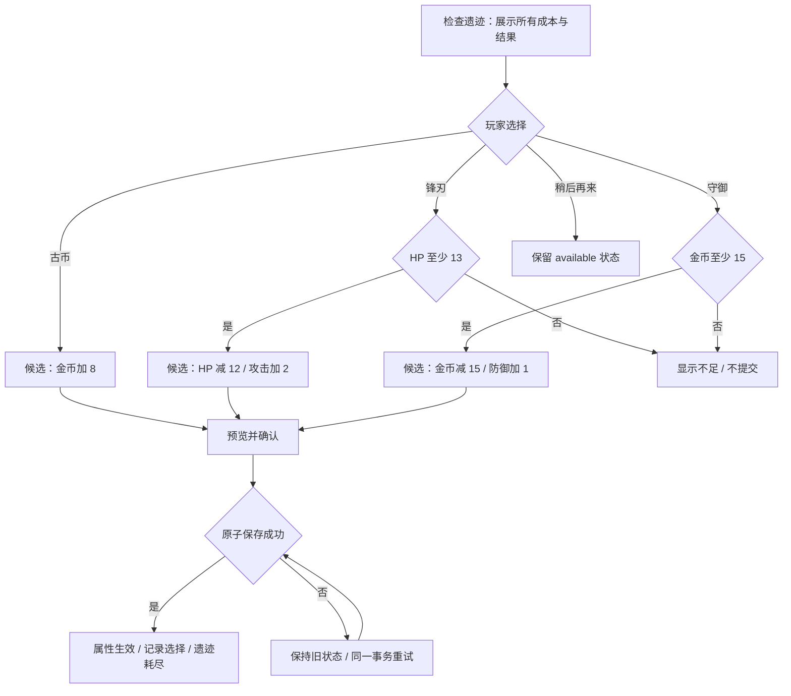

# 02 · 地图探索、遗迹决策与环境开发设计

状态：第三阶段设计稿 v0.1，2026-10-01。遗迹指可探索的一次性事件设施，遗物指持有后生效的物品，两者分开命名。新增内容、地图与数值均未实现。关联：[物品规则](01_BUILDS_AND_ITEMS.md)、[总册](README.md)。

## 1. 目标与不变量

玩家在地图中做三类判断：现在是否支付成本、先拿哪条支路的成长、是否标记后回来。每个选择都应能展示明确的资源变化和对已发现守卫的影响。

保留 11×11、四向、跨层回溯和一次性设施。普通层仍有安全楼梯通路；Boss 不可绕过。遗迹不得占据必要钥匙、固定成长、两处休息或两位商人的位置。所有新遗迹都允许免费离开，且不要求通过遗迹才能通关。

## 2. 十层职责与内容投放

| 层 | 固定成长/节点（沿用） | 新增或调整 | 玩家决策 |
| --- | --- | --- | --- |
| 1 旧王庭 | 铁剑、铁甲、骑士后的指环、嗜血剑/黄金剑 | 引导查看战损和标记骑士 | 先成长还是立即挑战；指环可回头 |
| 2 回声回廊 | 长弓/塔盾、主题支路 | 书库槽替换为 R1 誓约遗迹；首批机制遗物候选 | 生命、金币与属性之间取舍 |
| 3 灰烬集市 | 淬钢刃、商人 | 商店显示持币收益净变化 | 购物还是储蓄 |
| 4 封印前庭 | 板甲、休息、血斧精英 | 精英技能预告；挑战收益明确 | 现在打精英还是保血打 Boss |
| 5 牛头关隘 | 牛头与长枪/黑甲二选一 | 阈值战报与战前资源摘要 | 选择主方向 |
| 6 断誓兵库 | 另一件 Boss 装备、原遗物支路 | 熔炉槽替换为 R2 断誓锻台；进阶遗物 | 补短板或用生命上限换攻击 |
| 7 镜影回廊 | 翠玉冠、遗物支路 | 标记目标变得可打时提供非阻断提示 | 是否回第一层取指环 |
| 8 黑铁监区 | 商人、典狱长 | 高阶遗物/消费比较 | 终战准备还是挑战精英 |
| 9 黎明前室 | 休息点 | 隐士槽替换为 R3 守灯圣所 | 提前治疗、加强防御或攒金币 |
| 10 观星台 | 魔王与既有结局 | 展示石甲阈值和整局构筑贡献 | 战或暂退；结局顺序沿用 |

每座遗迹一局固定一处；遗迹的外观可按种子选装饰变体，但选项、成本和结果冻结，不在打开面板时抽取。

## 3. 遗迹 R1：誓约遗迹（2 层）

**意图：**用小而可理解的交换，教会玩家“基础属性与生命储备不能直接等价”。场景为半塌书库，石台上有断剑、灯罩与古币三个刻痕。

| 选项 ID | 名称 | 成本 | 收益 | 可用条件 | 结果 |
| --- | --- | --- | --- | --- | --- |
| `edge` | 刻下锋刃誓言 | 当前 HP -12 | 基础攻击 +2 | 当前 HP≥13 | 永久记录本局锋刃选择 |
| `guard` | 修复提灯座 | 金币 -15 | 基础防御 +1 | 金币≥15 | 永久记录本局守御选择 |
| `salvage` | 收集遗落古币 | 无 | 金币 +8 | 总是可用 | 永久记录本局搜寻选择 |
| `leave` | 暂时离开 | 无 | 无 | 总是可用 | 不消耗遗迹，可返回 |

前三者互斥且耗尽遗迹；离开不锁定。成本在确认时重新检查。面板显示选择后 HP/攻防/金币，以及一个已标记敌人的战损变化；没有标记则省略比较，不自动推荐某条流派。

原书库是免费攻击 +3 / 防御 +2，本提案改为更低且部分有成本的收益，属于明确削减而非无代价加内容。S3-B 必须重新验证前五层；若削减造成固定曲线问题，先调整本事件，不破坏固定军械。

### R1 决策图



## 4. 遗迹 R2：断誓锻台（6 层）

场景为断开的环形铁砧与残余青焰。展示 R1 的选择作为一句背景对白；R1 未使用或未发现也能使用全部选项，不提供隐藏奖励。

| 选项 ID | 名称 | 成本 | 收益 | 可用条件 |
| --- | --- | --- | --- | --- |
| `temper` | 锻造锋刃 | 金币 -25 | 基础攻击 +4 | 金币≥25 |
| `sacrifice` | 熔铸生命纹 | 基础最大生命 -10 | 基础攻击 +4 | 基础最大生命≥11，且派生最大生命降低后≥1 |
| `salvage` | 收集炉心余烬 | 无 | 金币 +15 | 总是可用 |
| `leave` | 暂时离开 | 无 | 无 | 总是可用，不消耗 |

最大生命成本专用规则：从玩家基础 `max_hp` 扣 10；派生上限随之降低，当前 HP 取 `min(当前HP, 新派生上限)`，不另外扣 10 当前 HP、不治疗、不删除装备。确认页显示当前 HP 是否被截断、最大生命永久损失 10。基础最大生命不足时禁止，不能靠装备临时撑起基础数值的负数。

当前 `RewardRules.COSTS` 不支持最大生命，本机制必须通过扩展后的纯交易函数执行并增加校验；不能偷偷使用负数 `effects.max_hp` 绕过非负校验。原熔炉为 20 金币换攻击 +6；新锻台是有意下调，须在整塔预算里重新校准。

## 5. 遗迹 R3：守灯圣所（9 层）

场景为熄灭的石灯和三道残存光路。圣所与本层原有休息点是两个不同实体，必须分别显示“剩余/已使用”。

| 选项 ID | 名称 | 成本 | 收益 | 选择理由 |
| --- | --- | --- | --- | --- |
| `restore` | 引回灯火 | 无 | 恢复 35 HP | 立即补足终战生命；满血时禁用并解释 |
| `ward` | 铭刻守灯纹 | 无 | 基础防御 +2 | 多回合战斗持续减损 |
| `reserve` | 取走祭灯金 | 当前 HP -12 | 金币 +30 | 跨持币阈值或回八层购物；HP≥13 |
| `leave` | 保留灯火 | 无 | 无 | 延后决定，事件不消耗 |

显示终战比较仅在魔王已被发现时开放；未发现只展示属性变化，不提前曝光怪物和结局。金钱方案是否有价值依赖持币遗物，不能通过仅比较攻击决定“最佳”。当前隐士原有治疗 30 / 最大生命 +20 并恢复 20；本提案替换后需记录生命上限曲线差异。

## 6. 地图规划图与几何约束

下图是可实施的普通层拓扑样板，不是截图。坐标原点左上角 (0,0)，四周封墙；`#`墙、`.`路、`D`来路楼梯、`U`去路楼梯、`R`遗迹、`G`可选守卫、`T`奖励、`P`原有补给、`K`既有固定成长占位。

```text
    01234567890
 0  ###########
 1  #####U#####
 2  #####.#####
 3  #R....#####
 4  #####.#####
 5  #####..G.T#
 6  #####.#####
 7  #P.......K#
 8  #####.#####
 9  #####D#####
10  ###########
```

- 主路：(5,9)→(5,1)，不经过守卫或遗迹；R=(1,3)，可免费检查后撤回。
- 精英支路：(5,5)→(9,5)，G=(7,5) 是 T=(9,5) 的割点；必须验证不能绕过。
- 另外两支路为 (1,7) 与 (9,7)，放本层既有补给和固定成长。K 仅表示占位：若现有成长规定有守卫，保留其守卫与切断关系，不能照图改成免费取得。
- 原有 `safe_slots` 的商人、休息、钥匙仍须预留。此样板仅在本层实体全部能容纳时使用；不能把实体堆在同格或覆盖图中的通路点。
- 对所有旋转/镜像重新计算槽位和守卫关系。摆不下则使用确定性的旧模板回退，并记录回退原因，不能删掉必要内容。

完整彩色规划图见 [遗迹与地图](diagrams/ruin-plan.svg)。同一图中的节点是逻辑关系，游戏内保持一个遗迹地图实体＋一张选项面板，不新增独立大场景切换。

## 7. 支路收益与回溯规则

| 支路类型 | 必须展示 | 生成约束 |
| --- | --- | --- |
| 精英奖励 | 敌人机制、预计最低 HP、确切两件候选 | 守卫先于奖励；未击败不可领取 |
| 锁门宝库 | 钥匙颜色和数量、门后已知收益 | 本层必要钥匙有安全可达来源；开门只扣一次 |
| 资源支路 | 金币/治疗准确数值、有效治疗和溢出 | 不刷新；药剂可保留 |
| 遗迹 | 成本、互斥结果、是否可以稍后再来 | 至少有免费离开；不足项可读不可提交 |
| 回溯目标 | 楼层、上次/现在战损、变化来源 | 只比较已发现目标；旧敌人不刷新 |

本阶段只优化导航信息，不加入自动传送。拟新增“查看楼层”定位和一步标记；获得装备后，若目标从致死变为存活，弹一条可忽略提示，不强制切楼。反复打开地图不会刷新“上次比较”基准；只有玩家再次标记或确认查看才更新基准。

## 8. 奖励预算与机会账本

仍使用全塔装备机会≤14、遗物机会≤17、商人=2、休息=2、事件=3。机会指所有展示候选，不是最终领取数。

1. 三座遗迹一对一替换 `event_floors` 的 library / forge / hermit；无额外物品候选，装备和遗物机会增加量均为 0。
2. 第二/六层主题遗物候选按 01 替换，每节点仍两候选；第 5 层与第 6 层另一件军械保持原奖励归属与额度规则。
3. 直接属性事件也必须记入独立 `direct_effect_budget`：分别记录 HP 成本、最大生命成本、攻击/防御收益、金币净收益与治疗，而不能因为不占物品机会就忽略强度。
4. 保守事件上界：三遗迹合计最多攻击 +6、或防御 +3；金币纯收益上界为 8+15+30=53，但第三项要付 HP。逐字段上界不是可同时取得的奖励包，模拟必须按实际选项路径。
5. 每局最多三次遗迹获益；离开与重入不增加次数。跨层、保存重试和结算页都不得重复触发。

## 9. 状态、接口与存档

拟新增 `data/phase3_ruins.json`、`scripts/core/ruin_rules.gd`、`scripts/ui/ruin_panel.gd`。沿用事件类型接入 `campaign_engine.gd`，不让 UI 直接改 Player。

```json
{
  "entity_id": "f2:ruin:0",
  "ruin_id": "p3_oath_ruin",
  "status": "available",
  "selected_option": "",
  "transaction_id": "",
  "rules_version": 1
}
```

`available → resolved` 是持久状态；`inspecting / previewing / submitting / save_error` 为界面或候选事务状态。事务键拟为 `run_id:entity_id:resolve`，只能提交一种结果；把费用、收益、记录、已耗尽状态和指标一起保存。重试使用同一候选，不重新计算随机候选；状态版本已变时重新预览。

读档时：已解决显示静态铭文；未解决仍可选；未知 option ID 或成本矛盾属于坏存档，不静默改为免费奖励。旧三事件继续使用快照中的原定义。

## 10. 环境模型与动画规格

| 对象 | 母版/运行图 | 分层与动作 | 状态可读性 |
| --- | --- | --- | --- |
| R1 石台 | 512/256 RGBA | 底座、断剑、灯座、符文；idle 4帧@4fps，resolve 6帧@10fps | 可用青绿符文；耗尽为熄灭裂纹＋文字 |
| R2 锻台 | 512/256 RGBA | 铁砧、炉心、烟、前缘；idle 4帧@4fps，resolve 8帧@12fps | 不用闪白遮盖 HP 成本 |
| R3 圣所 | 512/256 RGBA | 石灯、火芯、三条光路；idle 4帧@4fps，resolve 6帧@10fps | 治疗与防御结果分别以十字/盾纹标记 |
| 共同耗尽态 | 每种 1 帧 | 静态可回看铭文 | 不只靠颜色判断 |
| 回溯标记 | 128/64 RGBA | 2 帧弱呼吸；减动效静态 | 保留楼层数字与文字标签 |

遗迹主体限制在单格内，装饰光晕最多 1.2 格且绘于实体后方，不盖邻格钥匙/门。脚底锚点使用统一 manifest，不依靠 alpha 裁切后的隐式中心。全部三遗迹合计 35 张独立状态帧（12 idle＋20 resolve＋3 spent），可合图打包。

## 11. 实施与验收

先实现 R1 纯交易与面板，再加入安全槽与标记比较；前五层验证后才加入 R2 最大生命成本和 R3。最后接入三套环境动画。

| 验收 ID | 检查 |
| --- | --- |
| RU-01 | HP=12/13、金币=14/15 的选项可用边界正确 |
| RU-02 | R2 基础上限=10/11、当前满血/缺血时截断正确；无额外扣血或治疗 |
| RU-03 | 预览不修改玩家、地图、RNG 或遗迹状态 |
| RU-04 | 离开后可重进；已领取不可再领；保存失败不扣费，重试仅一次 |
| RU-05 | 三遗迹互不依赖；未用 R1 可用 R2/R3；免费退出始终可用 |
| RU-06 | 100 种子所有模板变换中安全通路、实体唯一、守卫割点、钥匙可达成立 |
| RU-07 | 事件预算、直接收益预算、候选机会账本一致；固定成长不被挤掉 |
| RU-08 | 320 宽下成本、收益、离开入口可见；长说明滚动不带动地图 |
| RU-09 | 目标从致死变可打提示只读、不泄露未发现怪物、不自动移动 |

试玩记录关注“为何选这一项、为何保留、是否记得回来”。如果某遗迹有 80% 以上玩家直接选同一项，先检查上下文和文字理解，再调整数值，不立即加随机惩罚。
