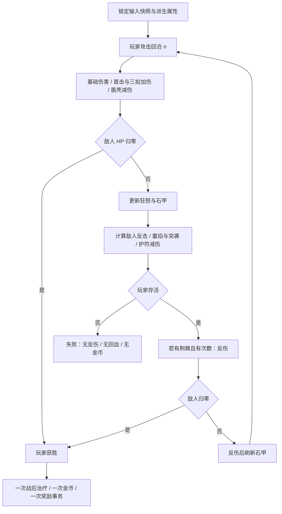

# 03 · 敌人机制、Boss 关卡与怪物动画开发设计

状态：第三阶段设计稿 v0.1，2026-10-01。现有数值从运行数据读取；变体与新效果为拟定。本阶段不添加即时闪避操作，挑战仍以确定性预览和资源规划为核心。

## 1. 敌人职责与现有基线

| ID / 名称 | 类别 | HP / 攻 / 防 | 击杀金币 | 当前机制 / 本阶段职责 |
| --- | --- | --- | --- | --- |
| `slime` 苔原史莱姆 | 普通 | 24 / 8 / 2 | 18 | 无技能；教学与早期固定成长 |
| `skeleton` 锈剑骷髅 | 普通 | 34 / 10 / 4 | 24 | 均衡属性；比较攻防收益 |
| `bat` 赤翼蝠 | 普通 | 30 / 13 / 2 | 26 | 低防高攻；攻击阈值收益 |
| `sentinel` 石壳卫兵 | 普通 | 48 / 13 / 8 | 34 | 厚甲；武器成长检查 |
| `warlock` 余烬术士 | 普通 | 52 / 19 / 5 | 40 | 当前遵循普通攻防，不自带穿甲 |
| `knight` 空心骑士 | 普通 | 72 / 20 / 10 | 48 | 回溯守卫；保留第一层指环门槛 |
| `berserker` 血斧狂徒 | 精英 | 65 / 18 / 4 | 40 | 前半局可选高攻检查 |
| `warden` 黑铁典狱长 | 精英 | 95 / 20 / 12 | 58 | 后半局可选高血厚甲检查 |
| `minotaur` 牛头守卫 | Boss | 120 / 18 / 8 | 65 | 每第三次玩家攻击后攻击 +2，当回合反击生效 |
| `golem` 魔王·深渊魔像 | Boss | 250 / **28** / 14 | 120 | 每损失累计 50 HP 防御 +2 |

魔像在基础 `content.json` 中攻击为 22，但十层 `campaign_rules.json.enemy_overrides` 覆盖为 28。第三阶段十层基线采用 28；两层试炼与旧局依其快照。不要用 22 的测试宣称新十层平衡。

## 2. 新变体（三种，替换可选守卫）

使用新 ID 保留旧敌人语义，不直接把旧术士改成无预警穿甲怪。外观必须有可辨特征与机制角标，不能只换色。

| 新 ID / 名称 | HP / 攻 / 防 / 金币 | 确定性技能 | 楼层与出现上限 | 应对方式 |
| --- | --- | --- | --- | --- |
| `p3_shield_sentinel` 盾壳卫兵 | 48 / 13 / 8 / 34 | 前 2 次玩家攻击受到的最终伤害各减 3，最低 1 | 3～4 层可选主题支路；全塔≤1 | 提高攻击或用续航承受长战 |
| `p3_ember_channeler` 蓄焰术士 | 52 / 17 / 5 / 40 | 第 3、6、9…次反击伤害 +5，正常受防御和格挡影响 | 6～7 层可选主题支路；全塔≤1 | 减少反击次数，或防御抵消蓄力 |
| `p3_vault_knight` 金库骑士 | 72 / 20 / 10 / 48 | 本场第一次实际反击额外 +4 伤害 | 8～9 层可选主题支路；全塔≤1 | 护符抵消部分首击，避免低血硬闯 |

前三者分别替换同层主题支路的 sentinel / warlock / knight；不替换固定军械守卫、第一层骑士或精英。没有符合原敌人类型的可选槽时该变体不出现，不额外加怪。每层最多一只变体。生成计划先预留变体，再进行主题展开，不在玩家接近后改变怪物。

S3-B 只落地盾壳卫兵，其余随 S3-D 扩展。若基础遗物对原敌人的选择差异已足够，可延后变体，避免一次改变太多因素。

## 3. 唯一战斗时序（新规则）

静态属性在战斗开始锁定，包括当前持币攻击、鎏金灯芯防御。临时格挡、护盾与反伤次数按每场重置。

具体公式：

1. `base_hit=max(1, player_attack-enemy_defense)`。
2. `raw_hit=base_hit + 首击加伤 + 三拍加伤`；盾壳有效时 `hit=max(1,raw_hit-3)`，并消耗一次受击次数。记录实际扣血为 `min(hit,enemy_hp_before)`。
3. 直接击杀时不反击、不消耗护符和反伤次数，不增加该回合狂怒。
4. 敌人生存：牛头在玩家攻击序号能被 3 整除时攻击 +2；魔像防御按 `base_defense + floor((max_hp-hp)/50)*2` 更新。
5. `raw_counter=max(0, enemy_attack+技能加伤-player_defense)`；护符有次数时 `counter=max(0,raw_counter-2)`。该次实际反击不论伤害为零与否都消耗一次护符次数。
6. 玩家 HP 减反击，归零即失败。存活且荆棘有次数，敌人扣 2 HP 并消耗一次；反伤击杀则获胜。反伤不算玩家攻击序号，不触发狂怒，但计入魔像累计失血并立即刷新防御。
7. 获胜后先结算总击杀治疗，再结算敌人金币＋幸运古币＋赏金账簿。新金币只影响下一场。第五层阶段额外治疗沿用当前战役奖励流程，不重复纳入战斗 `healing`。

战报新增字段拟为 `combat_rules_version`、`min_hp`、`effects_triggered`，每回合保留旧 `hit/counter/hp/enemy_hp/note`，增加 `enemy_hp_after_counter`、`retaliation_damage`、`guard_reduction`、`effect_events`。旧 UI 可以读原字段；新 UI 使用扩展字段正确显示反伤最后一击。`counterattacks` 计实际发生的反击，不计伤害是否为零。

对动画需要的“护盾触发次数”和“实际减伤”分别计数。护符消耗但原伤害=0 时实际减伤=0，不显示虚假的收益。

## 4. Boss 设计与阶段分镜

### 4.1 第五层牛头守卫

基础模式保留 120/18/8 和每第三击狂怒规则；第一轮不增加第二套隐藏阶段。战前展示第 3/6/9 次玩家攻击后的反击强化，战报标注触发点。玩家的关键判断是能否在下一次狂怒前结束战斗。

| 演出段 | 画面 | 时长目标 | 逻辑关联 |
| --- | --- | --- | --- |
| 入场 | 牛头放低重斧、封印门亮起 | 首遇 0.8 秒，可跳过 | 已确认战斗才播放，不收费 |
| 普通反击 | 0.12 秒抬斧、0.08 秒劈下、0.16 秒回收 | 0.36 秒 | 显示对应真实回合损失 |
| 狂怒 | 肩背符文亮、呼气、攻击数字 +2 | 与对应回合重叠 0.25 秒 | 必须先于该次反击命中帧 |
| 击败 | 斧落地、跪下、封印熄灭 | 0.6 秒 | 已保存结果，只展示 |

### 4.2 第十层魔王·深渊魔像

基础模式保留 250/28/14 和每 50 失血防御 +2。阶段是既有机制的可见解释，不额外回血，不重置 HP，不插入新 Boss。

| 累计失血 | 当前防御 | 外观提示 |
| --- | --- | --- |
| 0～49 | 14 | 关闭的胸甲、暗色裂纹 |
| 50～99 | 16 | 第一圈石甲闭合 |
| 100～149 | 18 | 肩甲符文亮起 |
| 150～199 | 20 | 胸部黑焰增强 |
| 200～249 | 22 | 核心暴露但外甲更厚 |

一次攻击跨越多个阈值时直接显示最终防御，附“跨越两层石甲”等文字；不拆成虚假的额外回合。致死一击后不继续播放加甲。击败后衔接现有营救→团聚→背叛/真身揭露，不能以新庆祝动画跳掉剧情。

## 5. 怪物模型与动画清单

地图怪物不巡逻，因此不为十种怪物都制作行走；把资源用于待机、攻击、受击与退场。战斗用正面偏侧视朝左的独立母版，地图用当前视角；两者不强行共用同一张静态图拉伸。

| 对象 | 模型分层重点 | 动作规格（帧数/FPS） | 制作顺序 |
| --- | --- | --- | --- |
| 史莱姆 | 核心、外膜、阴影 | idle 4/6，attack 6/12，hit 2/12，defeat 6/10 | 第一个普通怪样板 |
| 骷髅 | 头、胸、双臂、剑、腿 | 同普通怪规格；击打后骨架回位 | 第二批 |
| 赤翼蝠 | 身、双翼、翼尖、阴影 | idle 4/8，attack 6/12，hit 2/12，defeat 6/10 | 第二批 |
| 石壳卫兵 | 壳、核心、持盾臂、腿 | 普通规格；盾壳变体增加 guard 4/12 | 随前五层 |
| 余烬术士 | 身、兜帽、手、法球、火焰 | 普通规格；蓄焰变体增加 charge 4/8 | 后五层 |
| 空心骑士 | 头盔、胸甲、剑臂、披风 | 普通规格；金库变体增加威胁姿态 4/8 | 后五层 |
| 血斧狂徒 | 胸背、重斧、双臂 | idle 4/6，attack 8/12，hit 3/12，defeat 8/12 | 前五层 |
| 黑铁典狱长 | 面罩、铁臂、盾、锁链 | 同精英规格；链条不遮伤害文字 | 后五层 |
| 牛头守卫 | 头角、胸、双臂、斧、腿、怒纹 | idle 6/6，attack 8/12，hit 3/12，rage 6/12，defeat 10/12 | 优先于完整普通怪集 |
| 魔像 | 核心、头、胸甲、双臂、肩甲、裂纹 | idle 6/6，attack 10/12，hit 3/12，armor 6/12，defeat 12/12 | 第二个 Boss 样板 |

普通怪共 6×18=108 基础帧；两精英 46 帧；牛头 33 帧；魔像 37 帧；变体专用动作 12 帧，合计 236 帧位。不把调色复用计作全新帧绘制；变体必须有独立轮廓附件。地图 idle 可从各自动作母版单独烘焙，若新增方向或不同地图镜头，需额外计量，不把本表冒充双视角全部完工量。

规格：普通怪/精英 512 母版→256 运行帧；Boss 战斗 768 母版→384 运行帧，地图缩至 256 并保持脚底定位。牛头与魔像地图锚点沿用 (128,224) 的资源规范；战斗锚点在 manifest 显式定义。灯火、武器轨迹和石甲层是可独立关闭的特效层。

## 6. 工程接入

新增敌人定义拟放 `data/phase3_enemies.json`，新规则快照合并；在 `enemy_rules.gd` 添加技能白名单和参数约束。生成器仅替换合法可选槽。`combat_presentation.gd` 消费统一战报扩展；`monster_art.gd`、`runtime_art.gd` 增加动画资源映射，缺失新动作时回退对应静态图。

新 Boss 动画状态不写入战斗核心。加载后不恢复半截攻击；显示已提交结算，或按用户主动选择重放战报，重放不写存档。

## 7. 验收与调参

| ID | 必须检查的边界 |
| --- | --- |
| EN-01 | 敌人第一击被直接杀死时无反击、无狂怒、无格挡消耗 |
| EN-02 | 狂怒恰在第 3/6 次玩家攻击后生效；最后一击无额外触发 |
| EN-03 | 石甲 49/50/99/100 累计失血、一次跨多阈值、反伤跨阈值 |
| EN-04 | 玩家 HP 等于反击伤害时死亡；不发生死后反伤/回血 |
| EN-05 | 盾壳最低伤害 1；首击/三拍加伤先于盾减；护符零伤仍耗次数 |
| EN-06 | 反伤击杀的战报、伤害数字、奖励与最后画面一致 |
| EN-07 | 同 seed 与快照下生成一致；变体不覆盖固定成长和 Boss |
| EN-08 | 战前预览、执行、跳过、查看战报、重进结算所有数值一致 |
| EN-09 | 两层试炼、旧十层与新版各按自己的规则跑回归 |

基于实际路线比较新增怪与被替换怪的净损失差；初轮单只变体造成的额外损失若超过该段最大生命的 20%，进入调参复核而非立即硬削。重点检查低攻击混搭路线是否被盾壳卡死、守御路线是否在低攻敌人上完全无代价滚雪球。全塔可通证据按总册执行。
