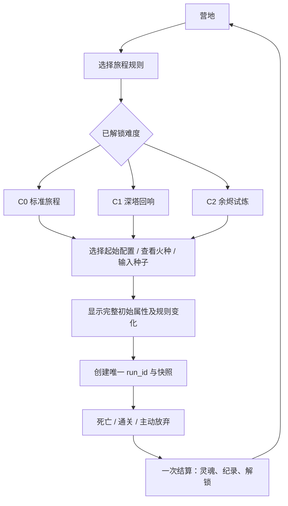

# 04 · 通关挑战、横向解锁与图鉴开发设计

状态：第三阶段设计稿 v0.1，2026-10-01。所有挑战、配置和解锁条件均为拟定；现有火种继续保留。关联：[构筑物品](01_BUILDS_AND_ITEMS.md)、[敌人与战斗](03_ENEMIES_AND_BOSSES.md)。

## 1. 目标与当前基础

当前账户有生命、攻击、金币三种火种，各三级；逐级价格 8/16/24 灵魂，每级分别初始最大生命 +5、攻击 +1、金币 +5，局后可免费退款重置。普通与精英各 2 灵魂、Boss 各 5、胜利另加 20，主动放弃为 0；保留这些规则。

下一阶段增加新的选择和完成目标，不继续无限叠加火种上限。所有基础通关必须可以零火种、基础起点完成。挑战和解锁不能改变进行中的旅程。

## 2. 营地流程与挑战梯度



| 难度 ID | 解锁 | 普通/精英 | Boss | 地图资源 | 奖励 |
| --- | --- | --- | --- | --- | --- |
| `p3_c0` 标准旅程 | 默认 | 基线 | 基线 | 基线 | 原灵魂规则 |
| `p3_c1` 深塔回响 | C0 通关一次；旧正式十层胜利亦承认 | HP×1.10 向上取整，攻击 +1 | HP 不变，攻击 +2 | 不变 | 相同灵魂＋首次徽记 |
| `p3_c2` 余烬试炼 | C1 通关一次 | HP×1.15 向上取整，攻击 +2 | HP×1.10 向上取整，攻击 +3 | 地图药剂和休息点的显式治疗量×0.80 向下取整，至少1 | 相同灵魂＋首次徽记 |

表内均相对基线计算，C2 不叠加 C1。防御、技能参数、金币、钥匙和固定军械不变。新变体以自己的基线应用相同缩放。

C2 的治疗减量只作用于 `potion` 地图实体和 `rest` 的 `heal` 字段；商店药剂、遗迹治疗、击杀治疗与物品增加最大生命时的自动恢复不减量。休息“上限 +20，恢复 20”变为上限 +20，恢复 16，文案显示实际规则。此限定为让规则可解释，若试玩认为绕过过多，下一版另行改规则版本，不能悄悄扩大作用范围。

没有额外失败惩罚和死亡次数加难。玩家可随时在新开局选择已解锁较低难度。当前局改难度需走既有放弃确认，不允许战前临时降低敌人属性。

## 3. 起始配置（三种可解锁＋基础）

起始配置只修改初始基础属性，不赠送稀有遗物，不占全塔奖励预算。应用顺序：原始玩家 100 HP/10攻/5防/0金币 → 配置差值 → 火种加值 → 新局 HP 设为最终最大生命。无永久被动和未写出的副作用。

| 配置 ID / 名称 | 零火种初始 HP/攻/防/金币 | 与基础的差值 | 解锁条件 |
| --- | --- | --- | --- |
| `default` 提灯旅人 | 100/10/5/0 | 无 | 默认 |
| `p3_vanguard` 先遣剑士 | 100/12/4/0 | 攻 +2、防 -1 | 新规则中存活击败第五层一次 |
| `p3_keeper` 守灯人 | 110/8/6/0 | 最大生命 +10、攻 -2、防 +1 | 新规则完成一局，胜负均可，实际击杀治疗累计≥20 |
| `p3_trader` 行商护卫 | 90/10/5/20 | 最大生命 -10、金币 +20 | 新规则完成一局，胜负均可，实际商店支出累计≥30 |

“完成一局”不含主动放弃，避免进入商店就放弃解锁。剑士的第五层条件在最终死亡/胜利结算时发放，不在 Boss 动画里直接写账户；若此后放弃则本次不发。所有门槛用基础起点可完成，没有需要先解锁自身才能达到的循环。

配置不可在一局中切换。火种金币三级的行商起点为 35 金币；不能重复套用配置或保留上一局金币。新配置可能改变早期生存压力，须逐一验证零火种路线；若某配置普遍更强，优先调整起始差值，不通过隐藏敌人加成补偿。

## 4. 解锁与成就全表

| 稳定 ID | 条件（新规则旅程） | 奖励/展示 | 何时提交 |
| --- | --- | --- | --- |
| `p3_first_midboss` | 击败牛头并最终死亡或胜利 | 先遣剑士配置 | 局末 |
| `p3_sustain_20` | 实际击杀治疗累计≥20，非放弃 | 守灯人配置 | 局末 |
| `p3_shop_30` | 实际商店支出≥30，非放弃 | 行商护卫配置 | 局末 |
| `p3_short_duel` | 击败牛头，玩家攻击次数≤6，非放弃 | 三拍剑穗进入后续新局池 | 局末 |
| `p3_low_loss_elite` | 任一精英战实际 incoming≤10 且获胜，非放弃 | 荆棘扣进入后续新局池 | 局末 |
| `p3_reserve_100` | 非放弃结算时金币≥100，最高到达层≥5 | 鎏金灯芯进入后续新局池 | 局末 |
| `p3_c0_clear` | C0 通关；可承认可信旧正式十层胜利 | C1 与铜色塔徽 | 局末/账户迁移 |
| `p3_c1_clear` | C1 通关 | C2 与银色塔徽 | 局末 |
| `p3_c2_clear` | C2 通关 | 金色塔徽与纪念图鉴页 | 局末 |
| `p3_no_embers` | 基础配置、零火种、C0 及以上通关 | 文字称号，不增加属性 | 局末 |
| `p3_three_ruins` | 同局使用三遗迹并通关 | 三段遗迹铭文合页 | 局末 |

“实际 incoming”是受到的原始总伤害，不是扣去击杀治疗的净损失，避免靠圣杯伪装低损失；次数从完整战报读取，不从演出抽样回合读取。已解锁时不重复奖励，解锁页展示“本次新增”和“累计完成”两组。

已解锁遗物只让未来新局的指定候选可用。不会插入当前局、刷新商店、重抽已生成楼层或强制稀释所有奖励池。仅按 01 的第六层替换槽参与。

## 5. 图鉴与剧透边界

| 类目 | 首次出现时 | 条件满足后 | 未发现时 |
| --- | --- | --- | --- |
| 怪物 | 已查看详情：外形、名称、机制说明 | 击败：次数、最低实际损失、所属难度 | 剪影、问号；不显示真实数值 |
| 装备/遗物 | 看见候选：名称和完整效果 | 获得：来源、联动标签、取得次数 | 仅显示收集数量，不列隐藏效果 |
| 遗迹 | 首次查看：场景与选项说明 | 已选择：记录本次与历史选项铭文 | 不展示后续遗迹正文 |
| 剧情 | 实际看到或主动跳过该已触发剧情后登记已到达节点 | 可回看文本/图；声音可关 | 王子真身与背叛相关条目锁定 |
| 成就 | 可理解的条件 | 完成日期、对应旅程 | 剧情成就用“完成塔顶故事”代替揭露内容 |

怪物数值随难度和版本不同，图鉴默认显示“基准数值”和当前选择难度的换算；历史最低损失按 `(enemy_id, combat_rules_version, challenge_id)` 分组，不能跨版本比较为同一纪录。界面显示原始样本次数，单次纪录不表示策略最优。

## 6. 复盘与本地指标

新增内容：初始配置、难度、关键遗物、三遗迹选项、商店净属性变化、最低战中 HP、主动放弃标记。地图复盘沿用只读模式。

拟新增本局指标：`actual_kill_healing`、`shop_gold_spent`、`min_hp_in_combat`、`ruin_choices`、`effect_counts`、`effect_actual_values`、`challenge_id`。击杀治疗累计只记真正恢复的 HP；售价只记实际交易成功金额，遗迹花钱不计商店消费。

效果贡献分两类：护符实际减伤、赏金额外金币可直接求和；“因为攻击提高而少受多少伤”涉及反事实模拟，仅在同一战前输入下移除指定效果重算，并标注“单项对照估算”。多个效果的对照收益不能相加冒充总收益，避免重复归因。

保留最近 30 局详细记录；累计成就、图鉴发现和总次数独立保存，不随旧记录裁剪丢失。此次不引入联网遥测、排行榜、每日登录或赛季倒计时。

## 7. 数据、事务与兼容方案

拟新增 `data/phase3_challenges.json`、`data/phase3_unlocks.json`、`scripts/core/unlock_rules.gd`、`scripts/ui/codex_panel.gd`。`campaign_progress.gd` 统一计算灵魂、纪录和解锁候选，`campaign_save.gd` 校验并提交。

```json
{
  "meta_schema_version": 2,
  "unlocked_ids": ["p3_c0", "default"],
  "achievement_ids": [],
  "codex": {"seen_enemies": [], "obtained_items": [], "seen_story_nodes": []},
  "unlock_rules_version": 1
}
```

上例为新增字段片段，不是替代原账户；灵魂、火种花费、失败计数和 records 全部保留。新旅程冻结 `challenge_snapshot`、`start_config_snapshot`、`unlocked_pool_snapshot`；同种子复试提供“按原规则重试”和“按当前规则新开”明确语义，原规则重试沿用完整快照但分配新的 run_id。

迁移策略：可信旧账户 `wins>0` 或既有 `first_victory` 只用于承认基础通关、开放 C1；旧局缺少精确的治疗、支出和战斗次数时不推测补发对应解锁。旧 run 保留原逻辑，新的 meta 字段填默认值。解锁规则未来更改不撤回已有解锁。

同一次结算候选包含 run 结束状态、灵魂、成就、图鉴累计及记录；保存失败则全部不提交。幂等依据唯一 run_id 和稳定成就 ID，不能只依赖会被裁剪的 30 局列表。当前活跃局的 committed 状态与账号最后结算键继续校验，扩展防重策略需覆盖恢复备份后的已结算局。

## 8. 界面与动画

营地增加“挑战设置”和“图鉴”次要入口，继续旅程仍为首要入口。新局面板先选难度、再选起点、再显示最终属性；不要让玩家到开局后才发现 HP 减少。

解锁动画：0.15 秒徽记显现＋0.25 秒文字展开，最多连续展示 3 条，多余折叠为“另有 N 项”；可直接跳过查看列表。每种难度徽记使用不同轮廓：单环、双环、三重塔冠；128×128 RGBA 图标，不仅换色。起始配置沿用公主模型，通过 UI 徽记区别，首版不制作三套新皮肤，避免起点差值被误解为换角色。

## 9. 验收与开发顺序

先做数据与纯解锁函数，再做营地设置与快照，再做图鉴，最后开放 C2。C0 未完成零火种验证前，不靠挑战档位掩盖基础平衡问题。

| ID | 检查 |
| --- | --- |
| UN-01 | 边界：治疗19/20、商店29/30、金币99/100、牛头6/7回合 |
| UN-02 | 主动放弃不发新成就和解锁；原灵魂0保持 |
| UN-03 | 新起点+火种只应用一次；非法/未解锁配置禁止开局 |
| UN-04 | C2非叠乘；HP向上取整、治疗向下取整；全 UI 显示实际数值 |
| UN-05 | C0/C1/C2金币与奖励不因动画或重复读取增加 |
| UN-06 | 同 run_id 重试保存/重进结算不重复发奖；records 裁剪不清累计解锁 |
| UN-07 | 解锁只改变未来新局池；当前局内容哈希不变 |
| UN-08 | 旧账号迁移保留火种和灵魂；不伪造旧局治疗与商店指标 |
| UN-09 | 图鉴与复盘只读；未知真身内容无缩略图/标题泄露 |
| UN-10 | 所有起点在C0有零火种完整参考路线；挑战通关证据独立记录 |
