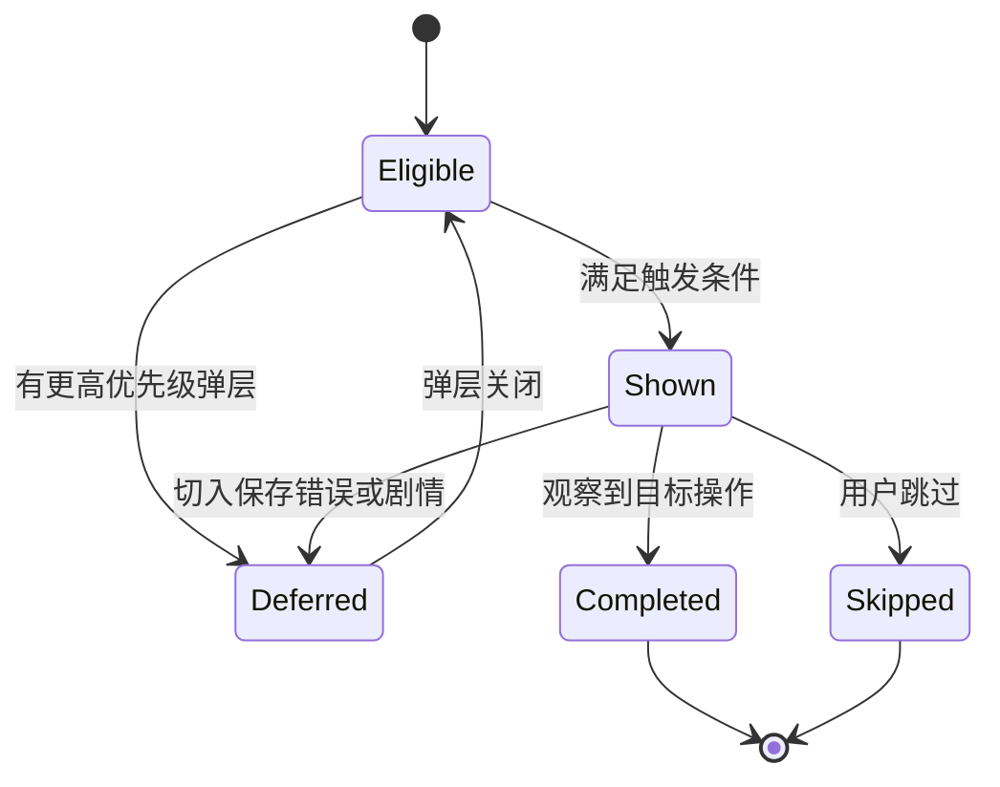
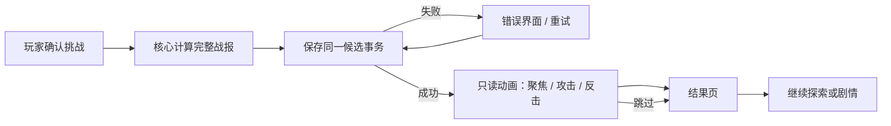

# 05 · 新手引导、模型动画与关键反馈开发设计

状态：第三阶段设计稿 v0.1，2026-10-01。本文件是美术制作与程序接入规格，不包含已制作的新模型、帧图或音频。关联：[物品](01_BUILDS_AND_ITEMS.md)、[遗迹](02_EXPLORATION_AND_RUINS.md)、[怪物](03_ENEMIES_AND_BOSSES.md)、[挑战](04_CHALLENGES_AND_UNLOCKS.md)。

## 1. 当前表现与升级目标

当前公主有四向静态图，正式行走尚未完成；旧草稿因交替腿与帧间稳定性不合格被保留为 rejected。已有战斗组件展示静态攻击/庆祝立绘、位移、闪色、火花、粒子、伤害数字、战报、跳过和减动效。

本阶段补齐真正的四向行走和战斗动作，让机制变化能在小屏上读懂。教学和动效不增加交互成本：普通拾取不反复弹窗，长战斗不逐回合强制播放，任何动画不修改游戏规则。

## 2. 首次游玩教学状态机

以实际操作事件驱动，不以等待秒数或只读完文字视为学会。教程仅首次默认开启，可跳过、从设置重置；重置教程不重置旅程、灵魂或剧情。

| ID | 触发 | 一句提示 | 完成证据 | 不满足时 |
| --- | --- | --- | --- | --- |
| T01 移动 | 新档进入第一层 | “点相邻地格，或使用方向键移动。” | 成功移动一步 | 不禁用其他合法操作 |
| T02 查看战损 | 首次点敌人 | “先看预计损失，再决定是否挑战。” | 查看过完整预览并关闭/确认 | 玩家可取消，无强迫战斗 |
| T03 成长比较 | 首次获得装备 | “装备已经生效，看看同一敌人的损失变化。” | 打开已发现敌人的对比 | 无敌人可比较时延后提示 |
| T04 钥匙与门 | 首次查看锁门 | “同色钥匙开门；开过的门不会再收费。” | 开门成功或主动关闭说明 | 不送免费钥匙改变种子 |
| T05 保留补给 | 缺血首次查看药剂 | “可以现在用，也可以留在这里。” | 使用或选择保留 | 满血时解释溢出，不强迫喝 |
| T06 遗迹选择 | 首次查看 R1 | “三项只能取一项，也能稍后回来。” | 领取或主动离开 | 费用不足项保留可读说明 |
| T07 回溯标记 | 查看第一层骑士且预计致死 | “标记目标，变强后再回来。” | 标记或选择暂不标记 | 若骑士已经可打则跳过此条件 |
| T08 局外与重试 | 首次结果页 | “灵魂可在营地升级，也能免费重置。” | 返回营地查看火种，或关闭提示 | 两层试炼不提示灵魂收益 |

同屏最多一个提示。优先级：保存错误＞致死确认＞战斗/奖励模态＞剧情＞教程＞普通提示。关键剧情排队时教程暂缓；教程不得截走“取消”的键盘焦点。



教程提示的关闭只记 `dismissed`，用户“跳过全部”记统一开关；不要误把未做的移动、领取登记为操作完成。账户级教程状态可放在 `presentation.cfg` 的版本化分组，写入失败不影响游戏交易；本次会话记忆仍可避免连弹，设置页允许重试保存。教程不作为玩法解锁前置。

## 3. 界面信息规格与线框

### 3.1 敌人预览

```text
┌ 牛头守卫 · 首领                         ┐
│ 生命 120    攻击 18    防御 8           │
│ 狂怒：每第三次攻击后，反击攻击 +2       │
├ 预计：可战胜 / 会战败                   ┤
│ 总受伤  X  · 战后恢复 Y · 净损失 Z      │
│ 战中最低生命 M  → 战后生命 H            │
│ [展开：回合与遗物效果]                  │
│ 奖励：金币 G，阶段奖励另列              │
│ [取消]                    [确认挑战]   │
└────────────────────────────────────────┘
```

X/Y/Z/M/H/G 全来自同一份模拟结果，文档符号不是写死的示例数值。致死时不以“战后回血”掩盖风险，主按钮明确写“仍要挑战”，默认焦点为取消。Boss 阶段治疗与装备候选不合并成战斗本身的金币/回血。

### 3.2 遗迹选择面板

```text
┌ 誓约遗迹                   [关闭]      ┐
│ 三项互斥，未选择时可稍后回来            │
│ 锋刃誓言：生命 -12 → 攻击 +2            │
│ 提灯修复：金币 -15 → 防御 +1            │
│ 收集古币：金币 +8                       │
├ 选中方案预览                           ┤
│ 生命 68→56，攻击 18→20，金币 23→23      │
│ 已标记目标：损失变化由实际模拟显示      │
│ [稍后再来]              [确认锋刃]     │
└────────────────────────────────────────┘
```

生命/攻击/金币行是单独演示 R1 扣费的合法示例；目标战损不编造。单击卡片只选择预览，主按钮才提交；双击与连点仍只能一次。内容区可滚动，底部确认/离开固定，背景地图不接收拖动和方向输入。

### 3.3 构筑与获得物品反馈

行囊顶部显示“当前联动”标签及来源，例如“储蓄增攻：黄金剑 +2、商王印记 +4”。不生成缺乏依据的“战力 999”。获得新装备时显示攻防与已标记目标损失变化；没有实质变化也明确显示“本场反击次数不变”，不承诺每次拾取都降低伤害。

## 4. 主角 2D 模型规格

沿用银白短发、青绿斗篷、右手剑、左手提灯、古金纹饰。四向由独立视图制作，禁止水平镜像造成左右手交换。保持现有轻俯视正交、小比例角色画风。

| 项目 | 制作要求 |
| --- | --- |
| 可编辑母版 | 分层 PSD / ORA / 工具原生工程任一；必须含图层命名、枢轴与动作源文件 |
| 地图尺寸 | 256×256 母版，128×128 运行帧；脚底锚点运行坐标 (64,116) |
| 战斗尺寸 | 768×768 母版，384×384 运行帧；脚底锚点拟为 (192,348) |
| 基础层 | 阴影、后披风、后腿、前腿、躯干、头发后、头、头发前、左上臂/前臂/手/灯、右上臂/前臂/手/剑、前披风、饰物 |
| 枢轴 | 骨盆、肩、肘、腕、髋、膝、踝；武器握点绑定右手，灯柄绑定左手 |
| 位移 | 动画根节点固定，不使用战斗根运动结算地图位移；地图移动插值由格子坐标驱动 |
| 导出 | RGBA PNG，真实透明；manifest 记录尺寸、锚点、帧序、FPS、loop、事件点 |
| 运行接入 | 优先烘焙 SpriteFrames；现有 Control 自绘地图通过资源适配读取帧，不要求整个地图改成 Node2D |

头、斗篷和灯可以有次级摆动；脚底接触帧的位移必须连续。原静态四向可用于造型核对，不将被拒绝行走草稿直接改名为正式帧。

### 4.1 主角动作表

| 场景/状态 | 方向 | 帧数/FPS | loop | 事件点与表现 |
| --- | --- | --- | --- | --- |
| 地图 idle | 下/左/上/右 | 每向4/6 | 是 | 呼吸与灯摆幅≤2运行像素；脚底稳定 |
| 地图 walk | 四向 | 每向6/12 | 是 | 左接触→承重→经过→右接触→承重→经过 |
| 地图 interact | 四向 | 每向4/10 | 否 | 伸灯检查；不改变左右持物 |
| 战斗 idle | 朝右偏侧 | 6/6 | 是 | 剑与灯保持可辨轮廓 |
| 战斗 attack | 朝右偏侧 | 8/16 | 否 | 帧0～2蓄力，3～4命中，5～7回收；命中点帧3 |
| 战斗 guard | 同上 | 4/12 | 否 | 护符有效时叠灯罩光，不虚构盾牌装备 |
| 战斗 hit | 同上 | 3/12 | 否 | 轻后仰，不强制整屏闪白 |
| 战斗 victory | 同上 | 8/12 | 否 | 举灯收剑，接现有胜利界面 |
| 战斗 defeat | 同上 | 6/10 | 否 | 单膝跪下、灯火暗，衔接现有失败故事 |

地图共 56 帧；战斗共 35 帧，总计 91 帧位。逐帧编号从 0 开始。地图每格移动插值目标 0.16～0.22 秒，行走循环 0.5 秒；连续移动时循环连续，短走停止可在最近接触姿态收尾，不强迫走完一整个循环才响应下次输入。

## 5. 动画状态与保存时序



视觉命中点只决定数字何时出现，不是扣 HP 的逻辑入口。切后台、关闭界面、跳过和动作资源缺失均不重新模拟或发奖。战报重放沿用只读数据。

动画状态优先级：defeat＞hit＞guard＞attack＞interact＞walk＞idle。该优先级仅用于角色表现，不能让插入 hit 的视觉状态吞掉已发生的攻击记录。完整战斗编排由战报调度器控制，角色状态机不独立决定回合顺序。

## 6. 战斗时间预算与长战斗压缩

普通战斗目标 1.2～3.0 秒，精英≤4秒，Boss 首次≤6秒；这些是演出目标，不改变战斗真实回合数。每个展示回合使用 0.50～0.65 秒的编排，攻击和反击可部分重叠。动画源片段可按回合预算缩放播放速率，但命中顺序不变。

长战斗最多展示六个真实回合。取样优先级：最后一击、首次新机制触发、首次狂怒/石甲、首回合，然后均匀补齐；若关键节点多于六个，合并为文字摘要，并明确标记“略过 N 回合”。反伤击杀必须展示最后反击及反伤，不能画成玩家下一次挥剑击杀。完整战报永不截断。

可视时序图见 [动画与事务图](diagrams/animation-timeline.svg)。减动效模式直接显示静态结算、机制文字和最终资源，无冲刺、震动、强闪光；音量设置独立保留。

## 7. 整批资产清单与优先级

| 批次 | 资产 | 数量/规格 | 完成定义 |
| --- | --- | --- | --- |
| A 样板 | 主角地图 walk、战斗 attack/hit，史莱姆、牛头 | 先交四向24行走帧与11战斗帧；怪物按03 | 能在实际地图和战斗播放，不能只有图集 |
| B 核心 | 主角其余动作、首批3遗物图标、R1 | 补齐91主角帧位；3图标；11遗迹帧 | 前五层整条体验成立 |
| C 后半 | 魔像、两精英及剩余普通怪、3变体专用动作 | 03共236战斗帧位；地图视角烘焙另计 | 每个生产 enemy ID 都有映射与回退 |
| D 探索 | R2、R3、后三遗物、回溯标记 | 24遗迹帧＋3图标＋2标记帧 | 状态与选择结果一一对应 |
| E 营地 | 3挑战徽记、3起始配置徽记、图鉴类别图标 | 128图标，4类图鉴图标 | 32px下可辨，不引入角色新皮肤 |

以上包含重复使用的帧位和图标，不可简单相加当成独立原画张数。地图怪物可以先保留正式静态图；地图待机动作完成后再替换，不把战斗帧强行缩小冒充新视角。

### 7.1 资源目录与命名（拟新增）

```text
assets/characters/hero/phase3/source/        可编辑模型、绑定与母版
assets/characters/hero/phase3/textures/      hero_walk_down_00.png 等
assets/characters/hero/phase3/manifest.json  动作、锚点与授权
assets/monsters/phase3/<enemy_id>/           分敌人资源与 manifest
assets/environment/ruins/phase3/            oath / forge / sanctuary
assets/items/phase3/                        六件遗物与图标
assets/ui/phase3/                           徽记、教程标记
```

source、草稿、审查截图添加 `.gdignore`；正式目录只放验收通过资源。作者、来源、生成提示词（如使用生成素材）、修改记录、许可证随资源保存。首版无需采购新工具或转用特定商用骨骼格式。

## 8. 特效与声音

| 事件 | 视觉 | 声音 | 节流 |
| --- | --- | --- | --- |
| 首击剑印 | 单次细金剑弧＋“首击 +4” | 短金属泛音 | 每战一次 |
| 护符减伤 | 灯罩轮廓＋实际抵消数值 | 轻碰撞声 | 每次有效反击一次；零收益不夸大 |
| 荆棘反伤 | 小反向刺光＋敌人扣血 | 短脆声 | 不触发第二串命中事件 |
| 赏金 | 金币旁“赏金 +10/+20” | 与金币音合并 | 结算一次 |
| 遗迹解决 | 对应符文亮起再熄灭 | 石/火/灯三种短音 | 保存成功后一次 |
| 目标可打 | 地图标记短亮＋文本 | 默认无声 | 同一状态变化一次 |

不新增长语音或强制对白配音。音量沿用已有设置，音频丢失不阻断交互。字幕/标签承担信息，静音不丢失技能提示。

## 9. 资源性能预算（目标）

运行帧优先打包不超过 2048×2048 图集，格间透明 padding≥4px；按人物/敌人分组按需加载，不把全部 Boss 与四向角色永久驻留。384×384 RGBA8 单帧未压缩约0.5625 MiB，主角35战斗帧约19.7 MiB，91帧全按384估算会夸大地图部分，应分别统计。

本阶段新增动画解码纹理驻留目标≤48 MiB，不等同于全进程内存或PNG文件体积；需计入图集空白、mipmap和缓存后实测。若超预算，先卸载非当前敌人图集和减少未使用方向驻留，再评估分辨率。目标机型未指定，本次不承诺帧率，只规定在固定测试机器上记录基线与新增内存/帧时差。

## 10. 工程改造

| 模块 | 责任 |
| --- | --- |
| `runtime_art.gd` / `monster_art.gd` | 根据实体与动作返回帧资源；静态回退；有界缓存 |
| `grid_board.gd` | 四向状态、地图帧推进、坐标插值；不改变地图逻辑坐标 |
| `combat_presentation.gd` | 真实战报编排、机制节点取样、跳过、暂停与减动效 |
| `presentation_settings.gd` | 教程版本与偏好、声音/减动效兼容 |
| `audio_feedback.gd` | 机制短音映射与节流，缺资源静默回退 |
| 拟新增 `tutorial_controller.gd` | 订阅成功操作事件、提示队列、完成/跳过状态 |
| 拟新增 `animation_catalog.gd` | manifest校验、帧资源加载、锚点和事件点 |

`map_screen.gd` 只接线，避免继续容纳所有新面板实现。教程控制器只观察交易成功事件，不订阅未提交按钮点击作为成功依据。

## 11. 逐帧与操作验收

| ID | 标准与证据 |
| --- | --- |
| AN-01 | 四向右剑左灯正确；无镜像换手；母版与已有角色身份一致 |
| AN-02 | 行走左右脚交替；接触帧脚底偏差≤1运行像素；静止根节点不漂移 |
| AN-03 | 透明边无白框；相邻图集无串帧；头身比例稳定，不以强制对齐掩盖错误步态 |
| AN-04 | 在26/33/47px格子分别看清方向和轮廓；战斗大图中无断肢、装备跳手 |
| AN-05 | 拟定的帧数、FPS、事件点、循环与资源引用自动校验；缺失动作回退可见 |
| AN-06 | 攻击/反击/反伤展示顺序与完整战报一致，跳过和读档资源结果相同 |
| AN-07 | 减动效直接结算；静音仍可理解机制；长战斗完整战报可滚动 |
| UX-01 | 320×640、360×640、540×960、900×960下成本、致死提示、关闭按钮完整 |
| UX-02 | 主要按钮≥48px、次要≥44px；Tab不进入弹层背后，方向键不穿透 |
| UX-03 | 双击确认、保存失败重试、动画中关闭/返回、剧情排队不重复结算 |
| UX-04 | 教程可跳过/重置；已完成不重播；读档不会强行送物或移动玩家 |
| UX-05 | 新玩家无需旁人口头说明完成移动、预览、领取、遗迹选择和上楼 |

验收素材包含逐帧联系图、原速/慢速录屏、三个小尺寸预览、四档UI截图及资源清单；不能只提供好看的一张关键帧就判定动画完成。失败帧保留在草稿目录并记录原因，正式 manifest 不引用它们。

## 12. 制作顺序

先做一套完整样板：公主四向走路＋一次攻击＋史莱姆受击＋牛头机制动画，放回实际 UI 审查。样板过关后批量制作其余对象；教学和静态机制提示可先接入，不等待全部美术。最后统一检查解锁、遗迹、剧情和存档错误之间的界面优先级。
