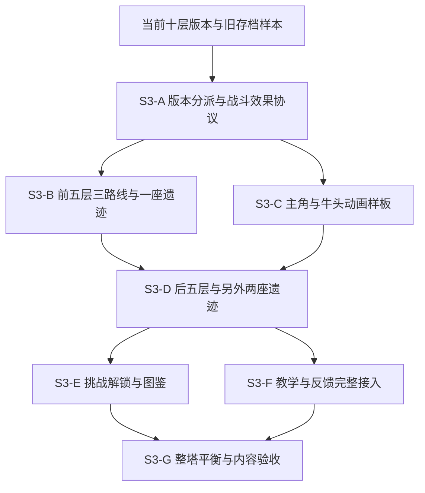

# 第三阶段：构筑、探索与重复游玩设计总册

版本：设计稿 v0.1 · 2026-10-01。适用工程：MagicTa / 塔境 · 公主救援记。

本次交付是五份设计开发文档及规划图，不代表功能、动画或数值已经实现、制作或验证。不包含微信接入、平台验证、联网、商业化和发布工作。所有标为“拟定”的数值均为首轮实现参数，须经生产模拟器和试玩校准。

**实施进展（2026-10-01）：** 五个模块已接入，随后补入 2/6/9 层遗迹专用布局、公主 91 帧位、史莱姆 18 帧位与遗迹 75 帧位。300 条 C0、240 条 C1/C2 整塔路线、12,000 层生成和四档 UI 已验证。当前范围与未完成项以 [续做记录](COMPLETION_FOLLOWUP.md) 为准；[集成结果](INTEGRATION_RESULTS.md) 保留第一批历史。其余敌人、美术精修、真人及客户端验收仍未完成。

## 1. 阅读入口

| 文档 | 负责的问题 | 主要交付规格 |
| --- | --- | --- |
| [01 构筑与物品](01_BUILDS_AND_ITEMS.md) | 这一局怎样成长，奖励如何改变选择 | 现有 22 件物品基线、新增 6 件遗物、效果时序、投放与经济、数据接口 |
| [02 地图与遗迹](02_EXPLORATION_AND_RUINS.md) | 去哪里，付出什么，何时回来 | 十层职责、11×11 布局、三座遗迹、分支决策、奖励预算、环境动画 |
| [03 敌人与首领](03_ENEMIES_AND_BOSSES.md) | 不同敌人要求玩家如何准备 | 现有十种敌人、三种变体、Boss 机制、战斗时序、怪物动画分镜 |
| [04 挑战与解锁](04_CHALLENGES_AND_UNLOCKS.md) | 通关后为何继续玩 | 三档挑战、三种起始配置、解锁表、图鉴、局外存档与复盘 |
| [05 引导与模型动画](05_ONBOARDING_AND_ANIMATION.md) | 玩家能否理解选择并感受到变化 | 教学状态机、界面线框、2D 分层模型、动作帧表、资产清单与验收 |

规划图可直接打开：[图册](diagrams/index.html)、[总体开发依赖图](diagrams/phase3-roadmap.svg)、[遗迹决策与地图图](diagrams/ruin-plan.svg)、[动画与事务时序图](diagrams/animation-timeline.svg)。每份正文还附 Mermaid 源图或文本线框，便于后续修改。

## 2. 当前事实与设计边界

基线读取自本地 `data/content.json`、`data/campaign_rules.json`、`scripts/core/`、`scripts/ui/` 及现有交付文档。比早期计划更新的代码与数据优先。

| 项目 | 当前状态 | 本阶段决定 |
| --- | --- | --- |
| 地图 | 十层、11×11、四向移动、回溯、六种普通模板 | 保持十层；增加路线决策，不靠空走延长局时 |
| 战斗 | 先手、确定性预览；狂怒、石甲；战后一次性提交 | 扩展有限被动效果，仍共用同一个模拟器 |
| 装备 | 12 件装备、10 件遗物；拾取叠加，无槽位 | 不引入装备卸装、随机品质和耐久 |
| 经济 | 两商店、两休息、三事件；装备机会 14、遗物机会 17 上限 | 新内容占用或替换机会，不无预算叠加 |
| 剧情 | 营救后已有王子背叛与真身揭露 | 保留现有结局顺序，图鉴避免提前剧透 |
| 局外 | 三种火种各三级、免费重置、灵魂与近 30 局记录 | 保留原基础成长；新增横向解锁 |
| 角色美术 | 公主四向静态可用；旧行走草稿未过步态验收 | 采用 2D 分层制作并烘焙帧动画，不转 3D |
| 战斗表现 | 已有攻击 / 庆祝立绘、位移、闪色、伤害数字、战报和跳过 | 在现有组件上增加真实动作和机制提示 |

“模型”在本套文档中指可编辑的 2D 分层角色模型及骨架/绑定母版；运行时优先使用透明 PNG 帧与 SpriteFrames。现有无骨骼静态图不能记作已完成模型绑定。3D 建模、实时光照与皮肤换装均不在本阶段。

## 3. 跨文档不可冲突的规则

1. 数值规则以 01 的效果定义和 03 的战斗时序为准；动画只读取已提交战报。
2. 遗迹普通事件共三处，替换 2 / 6 / 9 层事件槽；不占用固定装备、休息或商人槽。详细预算以 02 为准。
3. 两层试炼与旧十层存档继续走旧规则。新规则只用于新开第三阶段旅程，不能直接修改旧内容快照。
4. 现存 `campaign_save.gd` 对多个版本字段直接判定为 1，新增字段前必须实现明确的版本分派，不能只改一个 JSON 版本号。
5. 原有物品的副本叠加规则不变；新增六件机制遗物在新规则中每种最多持有一件。生成与奖励提交均校验，拒绝重复时不扣资源。
6. 主路安全、固定成长、第五层门槛和第十层通关条件不变；可选路线可危险，不能成为隐藏的必选解。
7. 无随机暴击、闪避或隐藏遗迹掷骰；所有风险先展示。剧情和演出不消耗地图 RNG。
8. 用户资料、运行存档、教程偏好分别维护；写盘失败阻断对应交易，成功后才展示领取、解锁和战斗演出。

## 4. 实施顺序与依赖

图中的分支是依赖关系，不表示已安排并行人员。先做小范围完整闭环，避免五套系统同时改写共享核心。

| 里程碑 | 具体交付 | 退出条件 | 粗估净开发量 |
| --- | --- | --- | --- |
| S3-A | 旧/新规则分派、效果协议、战报扩展、迁移样本 | 旧局预览不变；新效果有边界样例 | 3～5 人日 |
| S3-B | 01 首批三遗物、02 誓约遗迹、03 前段敌人、最小教学 | 同种子三类路线可打到并通过第五层 | 5～8 人日 |
| S3-C | 公主行走与战斗、牛头动作、物品图标样板 | 逐帧与小尺寸检查通过；跳过不改结算 | 6～10 美术/技术美术人日 |
| S3-D | 后五层变体、三座遗迹、十层预览与复盘 | 零火种基础起点可完成十层 | 5～8 人日 |
| S3-E | 难度、起始配置、图鉴、六件遗物全池 | 解锁幂等；旧账户兼容；无剧透 | 4～6 人日 |
| S3-F | 全部教学、机制提示、剩余角色与场景动作 | 主要交互与动作资源完整 | 8～14 人日，含剩余美术 |
| S3-G | 批量模拟、人工试玩、数值修订、交付证据 | 阻断项关闭，已知限制明确 | 4～6 人日 |

合计 35～57 人日是工作量估算，不是日历承诺；假设沿用画风、无需外包配音。美术返工可改变估算。若需要缩减，先推迟 C2、后解锁三遗物及普通怪死亡动作；不删预览一致性、存档和遗迹状态校验。

## 5. 平衡与验收共用规范

- 验证集：先固定 seed 0～99，另留 100～199 为未参与调参的验证集；同 seed、版本、挑战、起始配置、解锁池和主题选择序列才可复现同局。
- S3-B 验证五层；S3-D 验证整塔。必须通过生产移动、奖励、战斗及保存接口，不能使用满血单怪模拟代替整塔资源曲线。
- 基础模式、零火种、基础起点：每个固定测试种子至少一条参考策略通关；三条路线各保留完整示例。某路线失败不等于整个种子无解，但必须说明原因，不能从集合删掉难种子。
- 指标：到层 HP、最低战中 HP、攻防、金币、有效治疗、溢出、选择机会/实得件数、回溯步数、死亡点、局时。局时剔除暂停和后台；不靠自动测试证明“有趣”。
- 人工试玩目标：至少 5 人、每人两局；多数能解释一次放弃支路的原因与一次装备联动。20～40 分钟是待测目标，不强行填充战斗。
- 单一非教学选项选择率超过 75% 且不存在明显上下文差异时列入复核；样本少于 20 次仅记录，不直接判定失衡。
- 工程证据拟存放 `build/verification/phase3/`，包含版本、种子、快照摘要、日志和截图。此次仅交付文档，未运行这些未来功能测试。

## 6. 版本协议与实施落点

以下是拟定的版本分派协议，实施前以现有存档样本验证，不可直接把所有常量从 1 替换为 2。

| 版本维度 | 旧值/旧局处理 | 新局设计 |
| --- | --- | --- |
| 保存封装 `version` | 读旧 version=1 后迁移封装；原 run 内容保持 | version=2，容纳扩展 meta 与多规则 run |
| 账户 `meta_schema_version` | 缺失视为1，补解锁/图鉴默认字段 | 2，沿用灵魂、升级花费和既有记录 |
| `generator_version` / plan.version | 1继续旧生成器与快照 | 2支持遗迹、变体预留和候选替换 |
| `campaign_rules_snapshot.version` | 1调用旧规则校验 | 2校验直接奖励预算和新内容引用 |
| `combat_rules_version` | 缺失视为1，保留旧 simulate 语义 | 2支持触发效果与扩展战报 |
| `reward_rules_version` | 1保留旧奖励校验 | 2支持最大生命成本、新唯一遗物 |
| 挑战/解锁规则 | 旧局无挑战，按历史基线处理 | 各自版本1，存完整规则快照与 ID |
| 剧情规则 | 现有版本1 | 继续版本1，既有故事顺序不变 |

推荐保留对外的 `CampaignEngine`、`TowerCombat` 与奖励入口，在内部依据快照分派至旧/新实现。未知主版本拒绝读取并保留原文备份，不把未知机制视为无效果。旧封装升级成功前不覆盖主存档；迁移失败可继续用原版本恢复。由最外层保存事务提交 run/meta，子模块仅返回候选结果。

新内容文件均为拟新增：`data/phase3_items.json`、`phase3_ruins.json`、`phase3_enemies.json`、`phase3_challenges.json`、`phase3_unlocks.json`。它们加载后合入本局只读内容快照；UI 读取快照，不读取热更新后的全局表替换旧局数值。新增规则样例中省略的本地化名、说明和资源 ID，实施时必须补齐并通过内容引用校验。

## 7. 来源

[当前项目](../../README.md)、[第二阶段交付](../PHASE_2_DELIVERY.md)、[战斗表现](../COMBAT_PRESENTATION.md)、[主角素材现状](../../assets/characters/hero/README.md)。历史计划中的卡片流程、通用钥匙和未实现状态不能覆盖当前工程事实。
